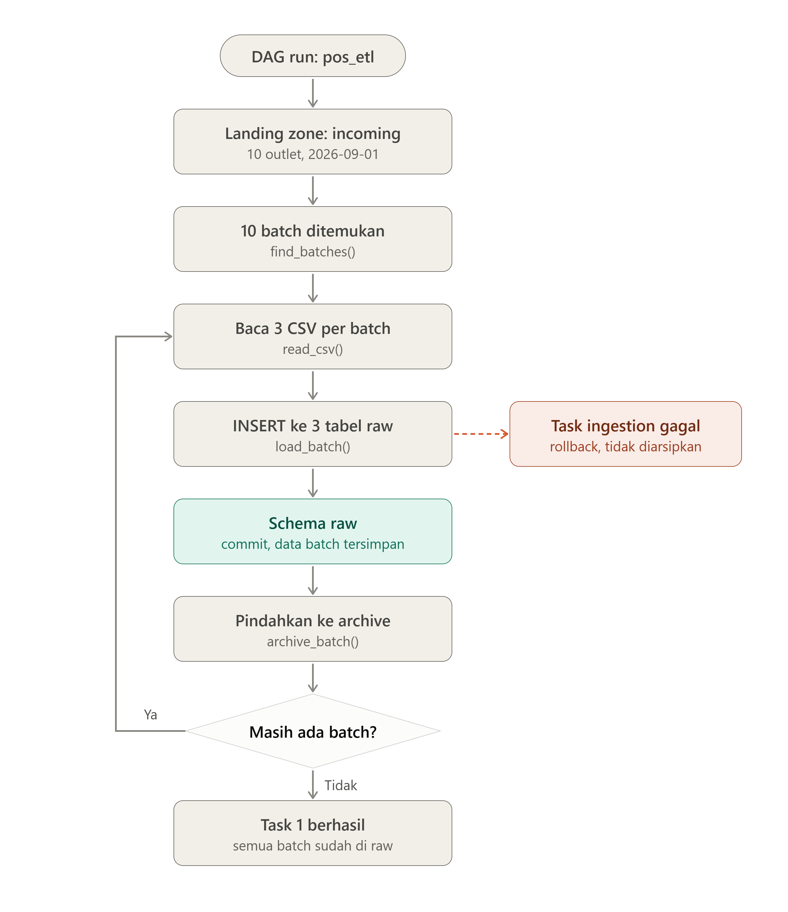
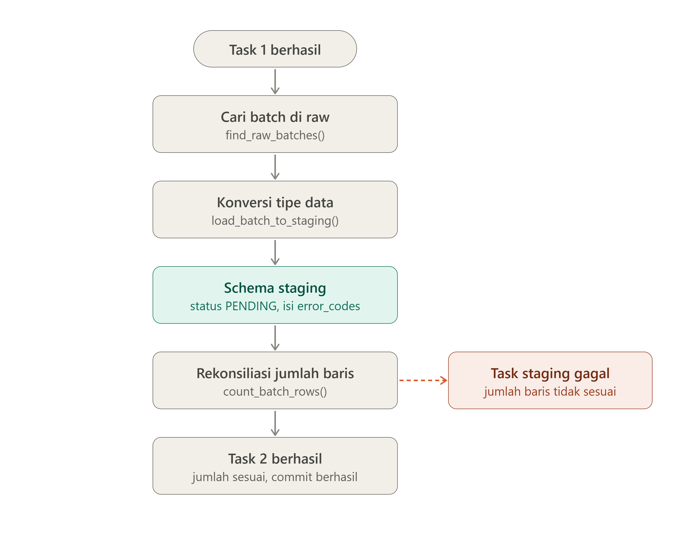
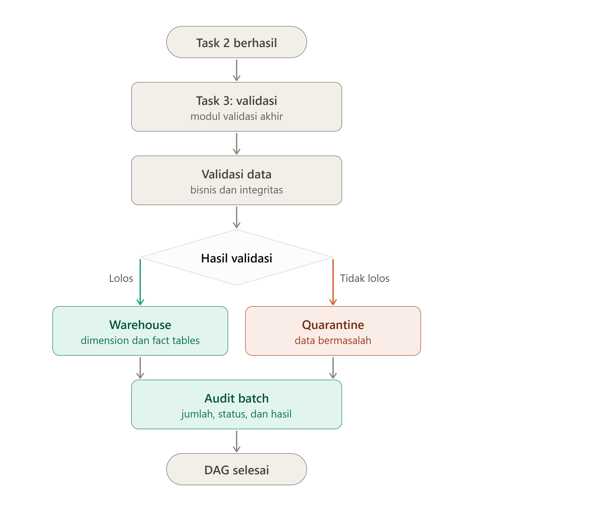

# POS ETL Pipeline — Apache Airflow + PostgreSQL

A production-style ETL pipeline for point-of-sale (POS) transaction data, orchestrated with **Apache Airflow 3** and loaded into a **PostgreSQL star schema**. The pipeline ingests daily CSV exports from multiple outlets, cleans and types them in a staging layer, validates every transaction against 8 business rules, and splits the result into a **warehouse** (valid rows) and an **audit / quarantine** layer (invalid rows) — so bad data is never silently dropped and never pollutes the warehouse.

Built as a data engineering portfolio project by **Haikal**.

---

## Table of Contents

- [Overview](#overview)
- [Architecture](#architecture)
- [Data Model](#data-model)
- [Validation Rules](#validation-rules)
- [Tech Stack](#tech-stack)
- [Project Structure](#project-structure)
- [Getting Started](#getting-started)
- [How to Run the Pipeline](#how-to-run-the-pipeline)
- [Results & Verification](#results--verification)
- [Design Decisions & Reliability](#design-decisions--reliability)

---

## Overview

Every day, each outlet of a POS system exports its transactions as CSV files. This project simulates that reality:

| | |
|---|---|
| Outlets | 10 (`O001`–`O010`) |
| Period | 2026-09-01 → 2026-09-30 (30 days) |
| Batches | 300 (1 outlet × 1 day = 1 batch) |
| Files | 900 CSV (transactions, transaction_items, payments) |
| Volume | 15,000 transactions · 37,357 items · 15,000 payments |
| Injected anomalies | 300 rows (~2%) across 4 anomaly types |

The pipeline moves data through three layers, each owned by one Airflow task:

1. **Raw (bronze)** — CSV files loaded as-is (all columns as `TEXT`, nothing cast or cleaned), with `batch_id` lineage.
2. **Staging (silver)** — typed, trimmed, and cleaned. Cast failures are caught with `pg_input_is_valid()` instead of crashing the load.
3. **Warehouse (gold) + Audit** — valid rows land in a star schema; invalid rows land in a quarantine table with an error code, and every batch run is tracked in an audit table.

---

## Architecture

One Airflow DAG (`pos_etl`), three TaskFlow tasks running in sequence:

### Task 1 — Ingestion (raw)



Scans `include/data/pos_exports/incoming/` for complete batches (an outlet folder + a valid date folder + all 3 CSVs). Each batch is loaded into the `raw` schema with everything stored as `TEXT` — no assumptions about the data. Successfully loaded files are moved to `archive/` so they are never processed twice.

### Task 2 — Raw → Staging



For every batch, rows are inserted into `staging` with:

- `TRIM()` + `NULLIF()` to clean whitespace and empty strings,
- `pg_input_is_valid()` to safely cast to the target types (`timestamp`, `numeric`, `integer`) — bad values become `NULL` and are tagged with error code **R8** instead of failing the whole batch,
- **Row-count reconciliation**: raw vs. staging counts must match for all three tables, otherwise the batch is rolled back.

A batch is only considered "done" when the raw row count equals the staging row count, so a half-loaded batch is retried on the next run.

### Task 3 — Staging → Warehouse / Audit



For every unprocessed batch (one DB transaction per batch):

1. `register_batch_run` — upsert into `audit.audit_batch_runs` with status `RUNNING`.
2. `validate_batch` — apply all 8 validation rules (below), mark every row `VALID` or `INVALID` with its error codes.
3. `load_quarantine` — invalid rows go to `audit.audit_quarantine_records`.
4. `load_fact_sales` — valid rows are joined to the dimension tables and inserted into `warehouse.fact_sales`, with two safety guards (every valid transaction must have exactly 1 payment row; inserted fact rows must equal the expected count, otherwise the batch fails loudly).
5. `finish_batch_run` — set final status: `SUCCESS` (no quarantined rows) or `PARTIAL` (some rows quarantined), plus row counts and timestamps.

---

## Data Model

Four schemas in PostgreSQL, defined in [`sql/create_tabels.sql`](sql/create_tabels.sql):

```
raw                              staging                          audit
├─ raw_transactions              ├─ staging_transactions          ├─ audit_batch_runs
├─ raw_transaction_items         ├─ staging_transaction_items     └─ audit_quarantine_records
└─ raw_payments                  └─ staging_payments

warehouse (star schema)
├─ dim_date      (calendar attributes, keyed by date_key = YYYYMMDD)
├─ dim_outlet    (outlet_id, name, city)
├─ dim_product   (product_id, name, category, list price/cost)
├─ dim_payment   (QRIS / Cash / Debit / E-Wallet)
└─ fact_sales    (grain: 1 row per transaction item, with quantity, amounts, gross_profit)
```

Notes:

- **Raw** is schema-on-read friendly: everything is `TEXT`, so a malformed file never breaks ingestion.
- **Staging** is fully typed, and carries `validation_status` + `error_codes` columns for lineage.
- **fact_sales** has a unique constraint on `item_id`, so a re-processed batch can never double-count.
- `dim_payment` is seeded in the SQL file; `dim_outlet` and `dim_product` are loaded from the generated reference CSVs in `include/data/reference/`; `dim_date` is generated with `generate_series()` (a ready-to-use snippet is in [Getting Started](#getting-started)).

---

## Validation Rules

| Code | Rule | Description |
|------|------|-------------|
| R1 | `DUPLICATE_TRANSACTION` | Same `transaction_id` appears more than once inside a batch |
| R2 | `INVALID_PRODUCT_ID` | `product_id` not found in `warehouse.dim_product` |
| R3 | `INVALID_QUANTITY` | `quantity` is `NULL` or `<= 0` |
| R4 | `PAYMENT_MISMATCH` | Sum of payments ≠ `total_amount` (tolerance 0.01) |
| R5 | `ORPHAN_ITEM` | Item row has no matching transaction header |
| R6 | `MISSING_PAYMENT` | Transaction has no payment row at all |
| R7 | `UNKNOWN_OUTLET` | `outlet_id` not found in `warehouse.dim_outlet` |
| R8 | `INVALID_TYPE` | Value failed to cast to the target type (set during raw→staging, survives retries) |

A transaction can carry multiple codes at once (e.g. `R4,R6`), and everything invalid is quarantined with a human-readable `error_detail`.

The synthetic dataset was generated with a 2% anomaly rate (300 injected anomalies):

| Anomaly type | Count |
|---|---|
| `INVALID_PRODUCT_ID` | 83 |
| `PAYMENT_MISMATCH` | 79 |
| `INVALID_QUANTITY` | 76 |
| `DUPLICATE_TRANSACTION` | 62 |

---

## Tech Stack

- **Apache Airflow 3** — TaskFlow API (`@dag` / `@task`), running on Astro Runtime 3.3
- **PostgreSQL 16** — raw / staging / warehouse / audit schemas
- **Psycopg 3** via `PostgresHook` — all DB work is done in set-based SQL, not row-by-row in Python
- **Docker** — Astro CLI (`astro dev start`) for Airflow, a separate `postgres:16` container (`pos_dwh`) for the warehouse
- **Python 3** — pipeline logic lives in `src/`, the DAG file only orchestrates

---

## Project Structure

```
POS_etl/
├── dags/
│   └── pos_etl.py                  # The DAG: 3 TaskFlow tasks, wired in order
├── src/
│   ├── ingestion.py                # find_batch / load_batch / archive_batch (raw layer)
│   ├── raw_to_staging.py           # find_raw_batch / load_batch_to_staging (typing + reconciliation)
│   └── staging_to_warehouse_audit.py  # validation, quarantine, fact load, audit trail
├── sql/
│   └── create_tabels.sql           # All schemas, tables, indexes, dim_payment seed
├── include/
│   └── data/
│       ├── reference/              # outlets, products (used to build the dimensions)
│       └── pos_exports/
│           ├── pending/            # Ready-to-ingest generated data (10 outlets × 30 days)
│           ├── incoming/           # The DAG reads batches from here
│           ├── archive/            # Files land here after a successful raw load
│           └── manifests/          # Generator metadata: batch_manifest.csv, run_summary.json
├── document/                       # Pipeline flow diagrams (task 1–3)
├── docker-compose.override.yml     # The pos_dwh PostgreSQL container
├── airflow_settings.yaml           # Local Airflow connections/pools/variables
├── Dockerfile                      # Astro Runtime 3.3
└── requirements.txt
```

---

## Getting Started

### Prerequisites

- Docker Desktop
- [Astro CLI](https://www.astronomer.io/docs/astro/cli/install-cli) (`astro dev start` is used below; plain `docker compose up -d` also works)
- pgAdmin or any PostgreSQL client, for inspecting the data

### 1. Start the services

```bash
astro dev start
```

This spins up the Airflow scheduler, API server, triggerer, and metadata DB, plus — via `docker-compose.override.yml` — the warehouse database:

| | |
|---|---|
| Container | `pos_dwh` (PostgreSQL 16) |
| Host port | `5433` → container `5432` |
| Database | `pos_dwh` |
| User / Password | `dwh_user` / `dwh_password` |

### 2. Create the Airflow connection

Airflow → **Admin → Connections → `pos_dwh` → Edit**:

| Field | Value |
|---|---|
| Conn Id | `pos_dwh` |
| Conn Type | `Postgres` |
| Host | `host.docker.internal` |
| Port | `5433` |
| Schema | `pos_dwh` |
| Login | `dwh_user` |
| Password | `dwh_password` |

> **Why `host.docker.internal` and not `localhost`?** The Airflow containers and the `pos_dwh` container sit on different Docker networks (Astro generates a new network name on every `astro dev start`), so container-to-container hostnames can't be relied on locally. Going through the published host port works on every restart. In a real deployment you would point this connection at your managed PostgreSQL instance instead.

### 3. Create the tables

Run [`sql/create_tabels.sql`](sql/create_tabels.sql) against the `pos_dwh` database (pgAdmin query tool or `psql`):

```bash
docker exec -i pos_dwh psql -U dwh_user -d pos_dwh < sql/create_tabels.sql
```

### 4. Build the dimension tables

The facts can't load without dimensions. Three quick steps:

- **`dim_outlet` / `dim_product`** — load from the reference CSVs. With pgAdmin use *Import/Export* and browse to the file on your machine; the `\copy` syntax below is for `psql` (the path is relative to wherever the psql client runs):

  ```sql
  \copy warehouse.dim_outlet (outlet_id, outlet_name, city) FROM 'include/data/reference/outlets.csv' CSV HEADER
  \copy warehouse.dim_product (product_id, product_name, category, list_unit_price, list_unit_cost) FROM 'include/data/reference/products.csv' CSV HEADER
  ```

- **`dim_payment`** — already seeded by `create_tabels.sql` (QRIS, Cash, Debit, E-Wallet).

- **`dim_date`** — generate it to cover the data period:

  ```sql
  INSERT INTO warehouse.dim_date (
      date_key, full_date, day_of_week, day_name, day_of_month,
      week_of_year, month_number, month_name, quarter, year, is_weekend
  )
  SELECT
      to_char(d, 'YYYYMMDD')::int,
      d::date,
      EXTRACT(ISODOW FROM d)::smallint,
      to_char(d, 'Dy'),
      EXTRACT(DAY FROM d)::smallint,
      EXTRACT(WEEK FROM d)::smallint,
      EXTRACT(MONTH FROM d)::smallint,
      to_char(d, 'Month'),
      EXTRACT(QUARTER FROM d)::smallint,
      EXTRACT(YEAR FROM d)::smallint,
      EXTRACT(ISODOW FROM d) >= 6
  FROM generate_series(DATE '2026-09-01', DATE '2026-09-30', INTERVAL '1 day') AS d
  ON CONFLICT (date_key) DO NOTHING;
  ```

---

## How to Run the Pipeline

1. Put some batches in the inbox. The repo already ships with fully generated data in `include/data/pos_exports/pending/` — just copy outlet folders into `incoming/`:

   ```bash
   # a single day from one outlet
   cp -r include/data/pos_exports/pending/outlet_O001 include/data/pos_exports/incoming/

   # or everything, for a full 300-batch run
   cp -r include/data/pos_exports/pending/* include/data/pos_exports/incoming/
   ```

2. In the Airflow UI, unpause the `pos_etl` DAG and trigger it (or `astro dev bash` and run `airflow dags trigger pos_etl`).

3. Watch the three tasks run, then inspect the results in pgAdmin (see below).

The DAG runs `@daily` with `catchup=False` and `max_active_runs=1`. Every task is idempotent: re-running the same batch deletes and reloads it at each layer, so a retry never duplicates data.

---

## Results & Verification


The screenshots below are from my **first full run of the pipeline**, which covered the **10 outlets** (`O001`–`O010`, September 2026) — 300 batches / 900 files in total. If you want to reproduce the run yourself, the generated data is already sitting in `include/data/pos_exports/pending/`: copy it into `incoming/` (see [How to Run the Pipeline](#how-to-run-the-pipeline)) and trigger the DAG.

### Airflow — successful DAG run

(document\result\dag_run_success.png)

### Raw layer (pgAdmin)

(document\result\dag_raw_layer_log.png)
(document\result\dag_raw_pgadmin.png)

### Staging — typed and validated

(document\result\dag_staging_log.png)
(document\result\dag_staging_pgadmin.png)

### Audit — quarantined records

(document\result\dag_quarantine_pgadmin.png)

### Warehouse — fact_sales loaded

(document\result\dag_validation_logs.png)
(document\result\dag_fact_sales_pgadmin.png)

## Design Decisions & Reliability

Things this pipeline does on purpose — the interesting part of the project:

- **Raw is untouched.** Everything is stored as `TEXT` with a `batch_id`, so bad source data can never break ingestion and every row is traceable back to its file.
- **Failures are quarantined, not thrown away.** Invalid transactions go to `audit.audit_quarantine_records` with an error code and description; the rest of the batch still loads. That's why batch status can be `PARTIAL`.
- **Set-based, not row-by-row.** All casting, validation and loading is done in SQL inside PostgreSQL — Python only orchestrates, so 300 batches process quickly.
- **Every batch is one transaction.** Each batch is processed with a single commit, and any failure rolls the whole batch back (no half-loaded state).
- **Reconciliation at every hop.** raw↔staging row counts must match; fact rows must equal the expected count from staging. Mismatches fail loudly instead of drifting silently.
- **Idempotent by construction.** Each layer deletes a batch's old rows before reloading it, and `fact_sales.item_id` is unique — so a retry or re-run never produces duplicates.
- **Lineage everywhere.** `batch_id` flows from the file name into raw, staging, quarantine, and the fact table; `audit.audit_batch_runs` records when each batch ran, how many rows loaded, and how many were quarantined.

**What I'd add next:** `dynamic task mapping` to process batches in parallel, a `Slowly Changing Dimension` strategy for `dim_product` price changes, data-quality checks with `Great Expectations` between layers, and alerting (Slack) on `PARTIAL` batches.

---

**Haikal** — data engineering portfolio, 2026.
